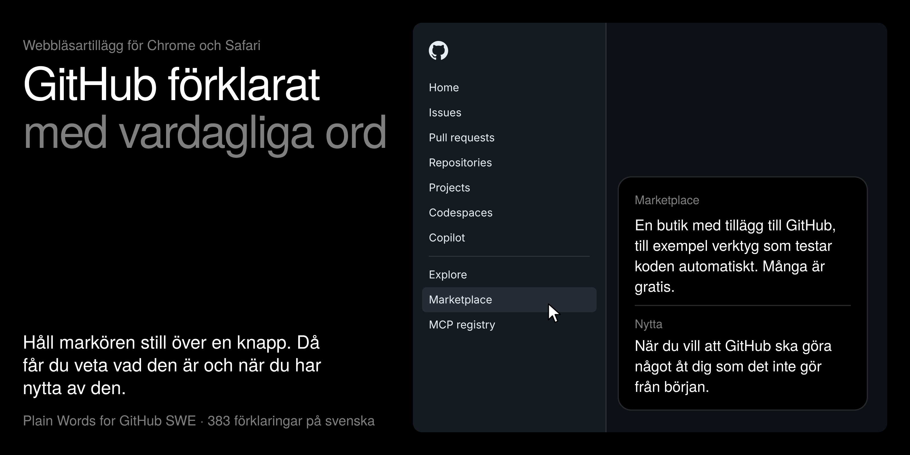

# Plain Words for GitHub SWE



**GitHub förklarat med vardagliga ord, på svenska.**

Många som börjar bygga saker med AI hamnar förr eller senare på GitHub. Där tar det ofta stopp, för allt är fullt av ord som fork, branch och pull request. Det här tillägget till Chrome och Safari förklarar sidan medan du använder den. Håll markören still över en knapp i en halv sekund, så får du veta vad den är och när du har nytta av den.

*English: a Chrome and Safari extension that explains every button on github.com in plain Swedish when you hover over it.*

## Det här får du

- **383 förklaringar** av knappar, flikar och menyer på github.com, från Star och Fork till Squash and merge.
- **Tre delar i varje bubbla:** GitHubs eget namn på saken, vad den är, och en rad om när du har nytta av den. Du lär dig de engelska orden på köpet.
- **Ingen AI, inget konto och ingen internetanslutning** behövs. Allt finns i tillägget.
- **Inget skickas någonstans.** Se [Integritet](#integritet).

## Installera

Det tar ungefär fem minuter i Chrome.

1. Hämta filerna: klicka på den gröna knappen **Code** högst upp på den här sidan och välj **Download ZIP**. Packa upp zip-filen.
2. Skriv `chrome://extensions` i adressfältet i Chrome.
3. Slå på **Utvecklarläge** (Developer mode) uppe till höger.
4. Klicka **Läs in okomprimerat tillägg** (Load unpacked) och välj mappen **extension** i den uppackade mappen.
5. Gå till ett projekt på GitHub, till exempel [facebook/react](https://github.com/facebook/react), och håll markören över knappen **Star**.

Steg för steg med fler detaljer, Safari och hjälp om något krånglar: [LASMIG.md](LASMIG.md).

## Använda

- **Visa en förklaring:** håll markören still över något på github.com i en halv sekund.
- **Stänga bubblan:** flytta markören eller tryck Esc.
- **Stänga av alla bubblor:** klicka på tilläggets ikon och slå av **Förklaringar**. Valet sparas.

## Integritet

Tillägget körs bara på github.com. Det läser sidan du tittar på för att hitta knapparna, och sparar bara ett enda val i webbläsaren: om förklaringarna är på eller av. Det samlar inte in något, skickar ingenting till någon server och har ingen spårning. Hela koden är öppen i mappen `extension/`.

## Ändra eller lägga till en förklaring

Alla förklaringar står i [`extension/explanations.js`](extension/explanations.js). Varje förklaring ser ut så här:

```js
{
  key: "fork",
  name: "Fork",
  text: "Gör en egen kopia av hela projektet på ditt konto. Originalet påverkas inte.",
  use: "När du vill ändra fritt i någon annans projekt, eller bygga vidare på det.",
  ids: ["fork-button"],
  texts: ["fork"]
}
```

`text` säger vad saken är. `use` säger när du har nytta av den och börjar alltid med "När". Kontrollera texterna med `node tests/check-texts.js`. Ladda sedan om tillägget på `chrome://extensions` och ladda om GitHub-sidan.

Förslag på bättre ord eller knappar som saknas tas gärna emot som en [issue](https://github.com/substnc/plain-words-for-github-swe/issues).

## Hur det är byggt och testat

Hur tillägget hittar rätt knapp, vilka val som gjordes och hur det är testat står i [docs/hur-det-fungerar.md](docs/hur-det-fungerar.md). Kort sagt: ett skript har hållit markören över varje knapp på riktiga GitHub-sidor, både inloggad och utloggad, och en textkontroll ser till att alla 383 förklaringar följer samma mall.

## Mappar

| Mapp | Innehåll |
| --- | --- |
| `extension/` | Själva tillägget. `explanations.js` har alla förklaringar, `content.js` visar pratbubblan. |
| `tests/` | Textkontroll, testsidor som härmar GitHub, och tester mot riktiga github.com-sidor. |
| `docs/` | Hur det fungerar och hur det är testat. |
| `tools/` | Skriptet som ritar ikonerna. |
| `bygg-safari.sh` | Gör om tillägget till en Safari-app på en Mac med Xcode. |

## Licens

[MIT](LICENSE). Du får använda, ändra och dela koden fritt.

Gjort av Anthon Bäckström. Ändringar per version står i [CHANGELOG.md](CHANGELOG.md).
