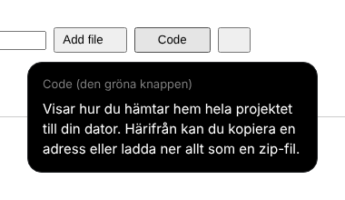

# GitHub-for-dummies

Ett webbläsartillägg för Chrome och Safari som förklarar knappar, flikar och menyer på github.com på svenska, med vardagliga ord. Håll musen still över något i en halv sekund så dyker en pratbubbla upp.

**Så installerar du det:** läs [LASMIG.md](LASMIG.md).

## Mappar

- `extension/` själva tillägget. `explanations.js` innehåller alla förklaringar.
- `tests/` automatiska tester och skärmdumpar. `tests/real/` testar mot riktiga github.com-sidor.
- `tools/make_icons.py` ritar ikonerna.
- `bygg-safari.sh` gör om tillägget till en Safari-app på en Mac.
